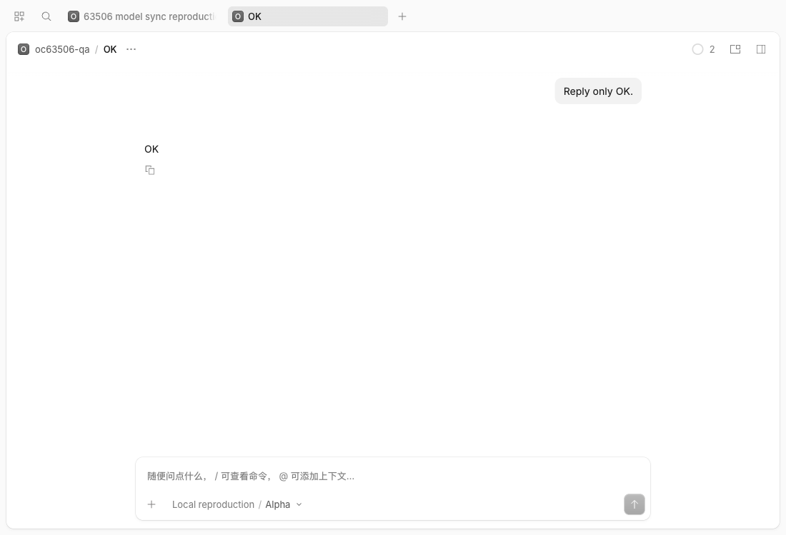

# Issue 63506: command model selection

Baseline: `37729b1df10cd0e3d0163a8ee6deba589503342c` (`dev`). Fix: `ffbfb49e94`.

## Reproduction

On macOS ARM64, open the production-built shared app in headed Chromium. Use a real source OpenCode backend, an isolated SQLite database and configuration, and a loopback OpenAI-compatible endpoint returning synthetic `OK` replies. No account or paid provider is involved.

1. Configure Alpha and Beta models and a global `switch-test` command with `model: lab/beta#low`.
2. Open a new session draft, explicitly pick Alpha at its default variant, and send `/switch-test` as its first message.
3. The session API reports Beta/low and the local inference endpoint receives `model: beta`.
4. On the baseline the composer still shows Alpha/Default. On the fix it shows Beta/Low.
5. Send the command again on the fix: both assistant messages report Beta/low, and the transcript still has only one model-switch event.

These are unedited screenshots of the shared app and real local backend, not packaged Electron acceptance or a real-provider interoperability test.

| Baseline | Fixed |
| --- | --- |
|  |  |

## Cause

`SessionInfo.fromRow` spells an absent variant as `default`. The composer expresses that same Default as `undefined`. Strict comparison retained a local override after creation or a commit, although the server had already accepted it. A command could switch to Beta while the stale Alpha override owned the label and next submission.

Normalize those representations for durable selection, promotion, acknowledgment and the submit comparison. Named variants and later unsent choices remain distinct.

## Validation

- The explicit-default promotion regression and headed browser regression fail before the fix. The browser expected Beta and received Alpha. The real source-backend reproduction independently shows the mismatch.
- Fixed: 2,591 app unit tests and 355 browser tests pass. All 66 focused tests pass ten repetitions while the full package suite runs.
- The new built Playwright regression passes 10/10 with five workers and no retries. It checks model/variant display, repeat submission without redundant switching, and a later manual choice.
- App production TypeScript, build, changed-file lint, formatting and diff checks pass.
- The broader composer run was 37/40. Two multiline-paste cases also fail on pristine dev with matching build flags on this macOS host. A Go-tray case failed once in parallel and passed isolated control runs on both revisions.
- Repository-wide Bun and TypeScript checks fail in unchanged CodeMode/transitive AI code; the CodeMode errors reproduce on pristine dev. The standalone e2e typecheck has exactly the same 181 diagnostics on both revisions. Full repository green CI is not claimed.
- Pre-change Strobe experiment `exp_efdc82` was inconclusive: NotSteady, background load, and a test file changed during setup. No performance claim.

Hosted CI, Windows/Linux execution and maintainer acceptance remain separate.
